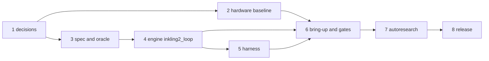

# Execution Plan: Inkling-2-Mini on one DGX Spark with REXL3

Owner: Justin Casey (`justincasey`)
Status: completed
Created: 2026-11-22
Last updated: 2026-11-24
Recipe: `~/recipes/Inkling-2-Mini-1x-DGX-Spark` (git; the work ran on the local branch `autoresearch/session-20261122`, whose history is not published; the public repository `justincasey/Inkling-2-Mini-1x-DGX-Spark` is an audited single-commit export made on 2026-11-24)
Companions: [PLAN.md](../../../PLAN.md) (lane, risk evidence) · [ROOFLINE](../../ROOFLINE.md) (ceilings, targets) ·
[FIT](../../FIT.md) · [DECISIONS](../../DECISIONS.md)

## Goal

Serve `vcruz305/Inkling-2-Mini-SAGE-REXL3-4.23bpw` @ `44c78c9d229b43dd45e41506071b9f5f939bed44` from **one** DGX Spark
behind an OpenAI-compatible API, built the way Inkling-2-Small, RED-SNOW and CYBERFROST were: the evidence-first
pipeline in `~/recipes/docs/RECIPE_INFLATION_PIPELINE.md` (intake, census, fit, pins, harness, static gates, hardware
bring-up, records, README), the REXL3 engine, byte-exact correctness gates, a mandatory memory guard, and a record behind
every number. Done means the acceptance criteria below, with the performance gap to the targets recorded either way.

## Context

| | |
|---|---|
| Pack | 13 files, 15,070,275,721 B; weights 14.000 GiB. EXL3 mixed K read from the trellis shapes: routed experts 4-bit (7,944 tensors) and 5-bit (1,272), attention / unembed / vision 6-bit, drafter 4-bit, embedding BF16. `mul1` codebook throughout. |
| Model | `Inkling2LoopForConditionalGeneration`: 26.4B total, 3.4B active. 24 layers, the middle 12 (6-17) run 3x with shared weights = 48 layer passes a token: 8 global-attention passes (layers 5, 11 x3, 17 x3, 23) and 40 sliding-window (1,024) passes. 128 experts, top 8, hidden 2,304. Vision tower (23 blocks). Block drafter `mtp.safetensors`: 3 layers, 7 drafted tokens a round, taps `[5, 23, 41, 48]` over the 48 passes. |
| Hardware | One GB10 Spark: 121.69 GiB unified, ~234-237 GB/s read, 93.4 TFLOP/s bf16, GPU clock locked at 2,200 MHz (site policy). All four Sparks hold the Inkling-2-Small TP4 group (read-only probe, 2026-11-22: 95-96% GPU, 11.2-12.7 GiB MemAvailable). That group displaced the DeepSeek-V4.1 4x ring (`spark-ds41f`), which normally owns the GPUs. |
| Roofline | A token reads 3.14 GB (experts 52%, attention 31%, unembed 11%, controllers 5%): serial ceiling 75.4 tok/s weights-only, 70.1 with int8 KV at 4K. The official checkpoint reads 5.55 GB (42.7 tok/s). Prefill 8.90 GFLOP/token of linears: 8,481 tok/s ceiling at 32K. MTP may not pay: an 8-row window reads 3.8x a serial step. |
| Engine | None serves this pack. REXL3's `inkling2` family is Small-only: no loop passes, Small's constants, exactly 4 ranks, BF16 dense weights, one K for all experts. Evidence in `PLAN.md`. Branches in `~/projects/REXL3`: `inkling2` @ `f4e27ca` (pin), `inkling2-a` @ `a73ff7a` (Segment A final, bit-exact, +45 commits), `inkling2-b` @ `c4a3a26` (Segment B1, bit-changing). |
| Engine base | The owner asked to pull the latest REXL commit and start the working branch there (2026-11-22). `git fetch --all` in `~/projects/REXL3`: upstream `main` is `02ef8cb` (2026-11-18; engine source tree v0.1.1, `.rexl3_commit` `75031112`). Branch `inkling2-loop` and worktree `~/projects/rexl3-inkling2-loop` start there and track `origin/main`; push only to the fork `justincasey/REXL3` (`origin`'s push URL is disabled, `upstream`'s is not: never push to it). Main has no Inkling family (the word appears once, in `crates/server/csrc/toks/src/gen/dict.c`). The Small branches fork from `06181b1`, one commit behind main: `inkling2` +25, `inkling2-a` +70, `inkling2-b` +83; a dry-run `git merge-tree` of `inkling2-a` onto `02ef8cb` is clean. Open upstream branches by `mr-r0b0t`, not on `main`: `engine/v0-1-3-engine-source` @ `387eabf` (engine source tree v0.1.1 to v0.1.3 `0c8bc43c`, one commit ahead), `engine/v0-1-3-notes` @ `a275d81` (three commits of release notes), `engine/approve-template-v1-4ee34195` @ `7b1b2a0`. Merging the engine-source branch with `inkling2-a` or `inkling2-b` conflicts in `crates/cuda/csrc/moe_prefill.cu`, `crates/cuda/src/moe_prefill.rs`, `crates/model/src/serve.rs`, `crates/server/src/http.rs` and `crates/server/src/main.rs`. |
| Reference | HF transformers `main` has `models/inkling2_loop/` (modeling 84 KB, modular 32 KB). vLLM `main` has `vllm/models/inkling2/`; Inkling 2 and Mini work is open there (#69249 Mini DSpark on SM120, #69181 sconv state on SM12x, #69096 drafter KV write). turboderp exllamav3 #617 "Inkling mini support" is open. |
| Scale reference | The Small family went from intake (2026-11-16) to its recorded four-rank base (Small recipe: `bench/records/2026-11-18-inkling2-final-base`) with a 44 KB port spec and a CPU fp64 oracle. Mini adds the loop, mixed K and dense EXL3 on top of that work. |

## Constraints

- One Spark, TP1, no fabric. Hardware steps need a node that nothing else holds; the Small group occupies all four, and
  stopping any rank ends it.
- Site policy: the GPU SM clock cap, 2,200 MHz (`GPU_CLOCK_CAP_MHZ` in `config/pins.sh`), is hardware protection and non-negotiable (owner,
  2026-11-23, D9): it is in place whenever any work runs on any node, applied (`sudo -n nvidia-smi -lgc 2200,2200`, lost on a reboot or a
  driver reload; the success line is required) before every server start, build, engine test and ops_dev run, and never released, raised
  or changed: no A/B across clocks, no `reset`, no exception for a measurement. Memory guard mandatory
  (2 GiB while loading, 1 GiB once ready, kill after 3 breaches, page cache dropped while loading); `MemAvailable` floor
  kept >= 10 GiB under load; API key through the environment, never argv; fail closed.
- Pipeline rules: no hardware run is the first execution of a code path (static tests first); controller dispatches
  from `main() { case ...; esac; }` with `main "$@"; exit $?` last (never edit it while it runs); a copy is verified on
  the destination; no number in the README without `bench/records/<date>-<profile>/meta.json`.
- **Carry-over from CYBERFROST and Inkling-2-Small (D5, taken as recommended when the owner said "OK lets do it" on
  2026-11-22; the owner may overrule):** byte-exact changes only, no lossy speed trade; kernels are REXL3-original: no code
  copied or paraphrased from other engines (CYBERFROST rule, 2026-11-10; the engine repo is AGPL-3.0-only and takes MIT,
  Apache-2.0 and BSD-3-Clause code only with attribution, `CONTRIBUTING.md` section 8); model semantics (what the model
  computes) come from the HF eager reference and vLLM's model definition, pinned by sha in the spec, as the Small port spec
  did (`PORT-SPEC.md` section 0), with a PROVENANCE line per engine commit; REXL3 contribution rules (never push to
  `REXL3/REXL3`, no tags or releases, `TYPE: Past-tense summary` titles of at most 90 characters, one logical change per
  commit, noreply identity, no internal project names, SAGE described only as "our own mixed-precision quantization method
  for EXL3; the method is not published", work on the `justincasey/REXL3` fork); every lane, build and worktree entered in
  `docs/CLEANUP.md` when created; optimisation validated at the full window with speculation and prefix cache on.
- **Agents (owner, 2026-11-22):** up to four at once. The lead integrates, monitors and advises; experiments, hardware runs
  included, are run by agents. See "Lanes and agents".
- **The Small group is production (owner, 2026-11-22):** it is stopped only in a node window under the protocol in "Lanes
  and agents", and restored, verified against its captured state, when the work that needs the nodes is done.

## Composition against the siblings

Audited 2026-11-22 against Inkling-2-Small-EXL3-4bpw-4x (the skeleton this recipe was scaffolded like), CYBERFROST-3.8-1x (the
one-node precedent) and RED-SNOW-5.3-Flash-2x. A rule is what all three share; what only one has is taken where it fits and
named. Status lives in the steps, not here.

| Element | Pattern (source) | Here | Step |
|---|---|---|---|
| Controller | one top-level `<recipe>.sh`; `.env` parsed, never sourced; caller environment over `.env` over defaults; remote scripts take variables by name; the dispatch is the last statement (all three; the pipeline's `main "$@"; exit $?` is stricter and is kept) | `inkling2mini.sh` | 5.2 |
| Pins | `config/pins.sh`: model repo and revision, `REXL3_UPSTREAM`, `REXL3_UPSTREAM_BASE`, `REXL3_FORK`, `REXL3_COMMIT`, `RUST_TOOLCHAIN` 1.89.0, not tunable from `.env` (Small, CYBERFROST; RED-SNOW keeps them inline) | `config/pins.sh` | 5.1, 4.8 |
| Engine build | `cargo +1.89.0 build --release --locked`, `REXL3_CUDA_ARCH=sm_121`, `REXL3_COMMIT` baked in; a commit that is not the pin is refused (CYBERFROST, RED-SNOW) or marked `engine.lab_build` (Small); binary sha256 in the record (Small) | `build` | 5.2 |
| One node | `setup` = preflight, install, download; no fabric, peers or ranks (CYBERFROST) | `setup` | 5.2 |
| Memory guard | `scripts/memguard.sh`, armed before the engine starts, mandatory (Small; CYBERFROST through `rexl3/node.sh`; RED-SNOW has none) | `scripts/memguard.sh` | 5.3 |
| Other stack | `STOP_OTHER` / `RESTORE_OTHER` commands behind `stop-other` / `restore-other` (Small); CYBERFROST wrote the stop by hand in its cleanup log | `.env`, controller | 5.2, 5.3 |
| Clock | The 2,200 MHz cap pinned in `config/pins.sh`; `gpu-clocks` takes `lock` or `status` (no reset, no MHz); the controller, `scripts/ops_dev.sh` and `scripts/gpu_cap.sh` apply it before any work and require the success line; a run that samples a clock above the cap fails (Small, CYBERFROST) | controller, `config/pins.sh`, `scripts/gpu_cap.sh`, `autoresearch.sh` | 5.2, 2.3 |
| Harness | `autoresearch.sh` as functions plus one last-line call; `METRIC` lines; `target_score` zero unless every required gate prints `PASS` (all three) | `autoresearch.sh` | 5.5, 7.1 |
| Pinned replies | `bench/reference.json` and `reference-vision.json`, written by `PIN=1` from the unmodified pinned commit (Small; CYBERFROST and RED-SNOW keep `reference.json` under `bench/rexl3/`) | `bench/reference*.json` | 4.8 |
| Static tests | `tests/test_recipe.sh` runs first in every `autoresearch.sh` run: `bash -n`, `print-serve` invariants, the guard on a fake `/proc/meminfo` (Small only) | `tests/` | 5.4 |
| Oracle | fp64 CPU reference, EXL3 decode, fixtures, teacher forcing; `docs/PORT-SPEC.md`, `NUMERICS.md`, `ORACLE-GAP.md` (Small only: it ported a new architecture) | `oracle/`, `docs/` | 3.1-3.3, 6.3 |
| Records | `bench/records/<date>-<name>/meta.json` written by `record`: recipe commit, pack, engine commit and sha256, config, command, results (Small; CYBERFROST names them by engine sha) | `bench/records/` | 5.2, 6 |
| Cleanup log | `docs/CLEANUP.md`: every build, lane, copy, log, profile and worktree entered when created (CYBERFROST) | `docs/CLEANUP.md` | 5.6 |
| Engine export | `docs/ENGINE_EXPORT.md`; `engine/<topic>` branches stacked on the upstream base in an export worktree (CYBERFROST) | `docs/ENGINE_EXPORT.md` | 8.2 |
| Plan, README | `docs/exec-plans/` active then completed (all three); README numbers cite records (Small, CYBERFROST; RED-SNOW cites scripts) | this plan, `README.md` | 8.1, 8.4 |

## Lanes and agents

Owner (2026-11-22): up to four agents at once; the lead integrates, monitors and advises and does not run experiments:
agents do, hardware runs included. A lane is one git worktree on its own branch (an engine lane also gets a build lane on a
node once it runs there); each is entered in `docs/CLEANUP.md` when created. Four Sparks are four timing slots, not four
idea lanes: before a first boot there are three independent engine areas (MoE with mixed K, attention, dense EXL3 and the
small ops), the spec and the host half compile and run on the Mac, and a timing run needs a node nothing else is compiling
on (CYBERFROST's 2026-11-10 outage: engine memory growth plus an unsupervised `cargo check` and `nvcc` on a lab node).

| Phase | Agents | Sparks |
|---|---|---|
| Wave 1, now (Mac): spec, oracle, engine host half and kernel audit, controller and static tests; read-only node probe | 4 | 0 (probe only) |
| Wave 2: bench tools (5.5), fixtures on the real pack (3.3), first GPU check of REXL3's existing kernels against the oracle | 2-3 | 1, first node window |
| Kernels (4.3): MoE with mixed K first, attention, dense EXL3 and small ops, one engine worktree each | 3 | 2 |
| Assembly, boot and gates (4.4-6) | 2: assembly (serial), drift and needle checks | 2 |
| Optimization (7) | 4: decode, prefill, speculation policy, memory and boot | 4 |

Wave 1:

| Lane | Agent | Worktree and branch | Owns | Steps | Ladder rung |
|---|---|---|---|---|---|
| spec | SpecWriter | `~/projects/inkling2-mini-spec`, `lane/spec` | `docs/PORT-SPEC.md`, `docs/NUMERICS.md` | 3.1, 3.2 | `spec` |
| oracle | OracleBuilder | `~/projects/inkling2-mini-oracle`, `lane/oracle` | `oracle/` | 3.3 (synthetic weights, EXL3 decode on real tensors) | `oracle-unit` |
| engine-host | EngineHost | engine `~/projects/rexl3-inkling2-loop-host`, `inkling2-loop-host`; recipe `~/projects/inkling2-mini-engine`, `lane/engine-notes` | engine `crates/` host half; `docs/KERNEL-AUDIT.md` | 4.2, mixed-K kernel audit | `engine-loop-host` |
| harness | ControllerHarness | `~/projects/inkling2-mini-harness`, `lane/harness` | `inkling2mini.sh`, `scripts/memguard.sh`, `tests/`, `.env.example`, `EVAL-MATRIX.md`, the `AGENTS.md` check block, the node-probe record | 5.2-5.4, 2.1 | `recipe-tests` |

Wave 2 (the node window has been open since 2026-11-22 22:45 CST; up to four agents run at once, the rest queue):

| Lane | Agent | Worktrees and branches | Node | Steps | Ladder rung |
|---|---|---|---|---|---|
| node ops | NodeOps | recipe `~/projects/inkling2-mini-nodeops`, `lane/nodeops` | node-2 (all four for the stop and the pack) | 2.2-2.4, first hardware use of the controller, engine build, real-pack oracle fixtures (3.3) | `roofline`, `engine-build`, `oracle-fixtures` |
| MoE mixed K | MoeLane | engine `~/projects/rexl3-inkling2-loop-moe`, `inkling2-loop-moe`; recipe `~/projects/inkling2-mini-k-moe`, `lane/k-moe` | node-1 | 4.3 (audit lane A) | `kernels-moe` |
| attention | AttnLane | engine `~/projects/rexl3-inkling2-loop-attn`, `inkling2-loop-attn`; recipe `~/projects/inkling2-mini-k-attn`, `lane/k-attn` | node-3 | 4.3 (audit lane B) | `kernels-attn` |
| dense EXL3 and small ops | DenseLane | engine `~/projects/rexl3-inkling2-loop-dense`, `inkling2-loop-dense`; recipe `~/projects/inkling2-mini-k-dense`, `lane/k-dense` | node-4 | 4.3 (audit lane C) | `kernels-dense` |
| chat template | ChatTemplate | engine `~/projects/rexl3-inkling2-loop-chat`, `inkling2-loop-chat` | none | 4.9 | `chat-template` |
| bench tools | BenchTools | recipe `~/projects/inkling2-mini-bench`, `lane/bench` | none | 5.5 | `bench-tools` |

The node lanes use `scripts/ops_dev.sh` (lead-owned: build lock, GPU lock `/tmp/rexl3-gpu.lock`, job cap, timeout, one lab tree per
lane). Node gates are decided by records: `scripts/check_record.py` takes the newest `bench/records/*/meta.json` with the gate id,
which must say `pass`, name a committed engine tree that is an ancestor of the engine head (a lane counts once merged), and carry
its test counts and metrics.

Wave 2 results (2026-11-22 to 23, all merged, ladder runs 3 to 8): the three kernel lanes passed their gates on three nodes
(`kernels-dense` 52 GPU tests, `kernels-attn` 105, `kernels-moe` 50: records under `bench/records/`), ChatTemplate passed
(17 server tests, 58 goldens against Hugging Face's environment), NodeOps recorded the roofline and the engine build; BenchTools
and the real-pack oracle fixtures (NodeOps) were still running (both finished and merged later: records `oracle-fixtures`, the tools under `bench/tools/`).

Wave 3 (the assembly; started 2026-11-23):

| Lane | Agent | Worktrees and branches | Node | Steps | Ladder rung |
|---|---|---|---|---|---|
| loop rank | LoopRank | engine `~/projects/rexl3-inkling2-loop-rank`, `inkling2-loop-rank`; recipe `~/projects/inkling2-mini-k-rank`, `lane/k-rank` | node-3 | 4.4, the per-visit state of 4.5, the dump hooks of 6.3 | `forward-oracle` (to add) |
| loop backend and first boot | LoopBackend | engine `~/projects/rexl3-inkling2-loop-backend`, `inkling2-loop-backend`; recipe `~/projects/inkling2-mini-k-boot`, `lane/k-boot` | node-4 | 4.4 (engine side), 6.1, 6.2 | `boot`, `smoke` (to add) |

The lead owns this plan, `README.md`, `config/pins.sh`, `docs/CLEANUP.md`, `autoresearch.sh`, `scripts/check_spec.py` and
the merges. Lanes commit only on their own branch. The lead merges with `--no-ff` into `autoresearch/session-20261122`
(recipe) and `inkling2-loop` (engine), runs `./autoresearch.sh`, and keeps a merge only if the ladder does not regress.

Node window protocol (the Small TP4 group is production; the owner asked for it back when the work is done):

1. Open a window only when wave 1 is merged, `inkling2mini.sh doctor` passes read-only, `tests/test_recipe.sh` is green, the
   host half compiles, and the window's agenda says what runs on which node and when it ends.
2. Capture the Small's running state, read-only, before any stop: per node the `rexl3-serve` command line and its `REXL3_*`
   and `NCCL_*` environment from `/proc`, `bin/rexl3-serve.commit` and the sha256 of `bin/rexl3-serve`, the guard's settings,
   `status` and `print-serve` of every rank, plus the Small recipe's git head and `.env` sha256 (never its contents). It
   goes to `.work/small-state-<date>/` (git-ignored; it holds lab addresses); a summary without addresses goes to
   `docs/CLEANUP.md`, "Services stopped".
3. Stop with the Small's own controller (`./inkling2.sh stop` in its recipe), confirm every rank's process and guard are gone
   and `/tmp/rexl3-gpu.lock` is free, then enter the stop in `docs/CLEANUP.md`.
4. Work through agents only. Every run holds the node lock and `/tmp/rexl3-gpu.lock` (the lock the Small's ranks hold, so
   the two recipes cannot overlap) and runs the memory guard; nothing compiles on a node except through the controller's
   `build`.
5. Restore with the Small's own controller and `.env`, never a rebuild: `./inkling2.sh start`, then verify against the
   capture: the `bin/rexl3-serve` sha256 and commit unchanged on all four nodes, `print-serve` byte-identical, each rank's
   command line and environment equal, the guard armed, `/health` 200, and `bench/tools/smoke.py` passing. Enter the
   restore in `docs/CLEANUP.md`. A window is not over until this passes; if it cannot, stop and report with the capture in hand. (Added 2026-11-24, after the cap rule: the Small's `start` does not apply the GPU clock cap, so the restore runs `./inkling2.sh gpu-clocks 2200 && ./inkling2.sh start`, or `./inkling2mini.sh restore-other`, which does exactly that.)

## Targets (proposals; D3 stayed open: the owner set three stretch targets instead, step 7.4)

Authoritative copy and the rules that produced them: [ROOFLINE](../../ROOFLINE.md). The table is the proposal and was never confirmed or replaced; the three targets the owner set are in step 7.4 and none was met (Completion Summary).

| Metric | Ceiling | Target | Stretch |
|---|---:|---:|---:|
| decode c=1, 4K, serial | 70.1 | 62 | 65 |
| decode c=1, 4K, MTP | 108 | 77 | 92 |
| decode c=1, 32K / 128K / 256K / 1M, serial (int8 KV) | 61.5 / 43.3 / 31.0 / 11.5 | 54 / 38 / 27 / 10 | 57 / 40 / 29 / 11 |
| decode c=1, 32K / 128K / 256K / 1M, MTP | | 72 / 60 / 49 / 23 | 85 / 70 / 56 / 25 |
| decode aggregate, 4 / 8 streams | 113 / 137 | 89 / 108 | 105 / 127 |
| prefill cold, 8K / 32K | 9,525 / 8,481 | 2,380 / 2,120 | 3,810 / 3,390 |
| prefill cold, 128K / 256K / 1M | 5,894 / 4,191 / 1,533 | 1,470 / 1,050 / 380 | 2,360 / 1,680 / 610 |
| ready after `start`, cold page cache | | <= 20 s | |

## Acceptance Criteria

- [x] `./inkling2mini.sh setup` (or `doctor`, `fetch`, `verify`, `build`) brings the pinned pack and engine to one
      node; `start` boots with the guard, `/v1/models` answers, ready memory and the KV capacity line are logged.
- [ ] Correctness gates pass (Phase 6; met except the tool-call gate, a recorded fail: `final-quality-tools`, 25 of 28; `longctx` and `sixcat` were not run): smoke (chat, completion, tool call, reasoning, image), oracle op-level teacher
      forcing, drafted == serial, cached == uncached, concurrent == solo, chunk width changes no byte, boot to boot,
      needles at the window, quality and tool baselines recorded, `api-test` 0 FAIL.
- [x] Every figure in the README has a record; the pinned replies are byte-exact against the engine's own reference.
- [x] Targets met, or the shortfall and its cause recorded against `docs/ROOFLINE.md` (the shortfall is recorded; the three stretch targets were not met).
- [x] `docs/CLEANUP.md` lists every lane, build, copy and worktree. The Small group was stopped and is not restored: the owner asked (2026-11-23) to leave the latest Mini version up on node-1 to test; `./inkling2mini.sh restore-other` restores it.

## Steps

Status values: done, partial, in progress, pending, blocked (names the decision). Closed 2026-11-23: every row below carries its final status (a `Final:` clause where the final run gives the closing fact). Wave 1 (Phases 3, 4.2 and 5.2-5.4, plus
the read-only part of 2.1) runs now on the control machine in the lanes above; 2.2-2.4, 4.3 onward and 6 need a node window.

### Phase 0: intake and targets

| # | Step | Status | Artifact |
|---|---|---|---|
| 0.1 | Intake: manifest with sha256 (13 files), census (10,075 modules, no weights downloaded) | done | `intake/` |
| 0.2 | Roofline and targets from recorded hardware ceilings; official-checkpoint comparison | done | `docs/ROOFLINE.md`, `scripts/roofline.py`, `scripts/official_bytes.py` |
| 0.3 | Scaffold with `scripts/new_recipe.sh`; folder renamed to the sibling convention | done | `Inkling-2-Mini-1x-DGX-Spark` |
| 0.4 | Git: repo on `main`, noreply identity, no remote | done | local commits |
| 0.5 | Engine audit of `inkling2` against Mini; read-only probe of the four Sparks | done | `PLAN.md` open risks |

### Phase 1: owner decisions

| # | Step | Status | Artifact |
|---|---|---|---|
| 1.1 | Answer D1-D6 (table below) | partial: D1, D2, D5 and D6 settled 2026-11-22 (Decisions); D3 and D4 open. Final: D7 to D9 were settled 2026-11-23; D3: the proposals stay in `docs/ROOFLINE.md` and the owner set the three stretch targets of 7.4 instead; D4: the shipped profile is `bootstrap` (`long` and `max` measured), the repository destination (8.3) is open | this plan, Decisions |

### Phase 2: hardware baseline (needs one free Spark)

| # | Step | Status | Needs | Artifact |
|---|---|---|---|---|
| 2.1 | Read-only probe of the node: GPU idle, MemAvailable, containers, disk, `sudo -n`, `nvcc` 13.0 | done 2026-11-22 (lane harness): the Small idle on all four nodes, MemAvailable 11.1-12.7 GiB beside it, one container `other-service-1`, node-2 has no Rust toolchain | node | `bench/records/2026-11-22-node-probe/` |
| 2.2 | `tools/roofline.cu` on the node. First add this model's GEMM shapes (4096x2304x3072, 4096x3072x2304, 256-row expert GEMMs 2304x1152 and 1152x2304), compile-check, then run idle. Update `HW` in `scripts/roofline.py` if bandwidth or bf16 differ by more than a few percent | done 2026-11-23 (NodeOps, node-2): DRAM read 234.0 GB/s (recorded 233.8), bf16 92.6 TFLOP/s at 8192 (recorded 93.4), fp8 194.8; within 3%, so `HW` is unchanged | 2.1 | `bench/records/2026-11-23-roofline/` (METRIC lines, `meta.json`, clock samples) |
| 2.3 | Lock the GPU clock at 2,200 MHz and sample it under load | done (NodeOps, `sudo -n` works, locked on all four nodes); under load the kernel lanes sampled 2,177-2,184 MHz | 2.1 | clock samples in the records |
| 2.4 | Stage the pack once (14.0 GiB, `hf download` at the pinned revision) at `/home/spark/models/Inkling-2-Mini-SAGE-REXL3-4.23bpw`; sha256 against `intake/manifest.tsv` | done 2026-11-22 22:54 (NodeOps): the 13 files verified on all four nodes | 2.1 | `verify` output |

### Phase 3: spec and oracle (control machine, CPU)

| # | Step | Status | Needs | Artifact |
|---|---|---|---|---|
| 3.1 | `docs/PORT-SPEC.md`: op-by-op forward of the target (loop: controllers' gain / forget / down, cross-pass queries, AttnRes across 48 passes, per-pass KV, ring and conv state), the 3-layer drafter (taps over passes, Markov head), the vision tower at hidden 2,304; tensors, shapes, rounding points, an UNKNOWN list. Sources pinned by sha: HF `inkling2_loop`, vLLM `inkling2`, pack config and headers | done 2026-11-22 (lane spec, 1,314 lines, `check_spec.py` passes). Corrections to the plan: the vision tower is width 1,024 (2,304 is the projector output, the patch embedding is BF16); the drafter taps are visit indices (the input of visits 5, 23, 41 and the final-norm output) | D5 (settled) | spec |
| 3.2 | `docs/NUMERICS.md`: settle the UNKNOWNs | done 2026-11-22 (lane spec): 21 UNKNOWNs, 17 resolved, 4 open (9: does the engine's template renderer run ``; 15: which half of the expert pair is the gate; 17: the quantized Markov head fold; 20: int8 KV across three passes) | 3.1 | numerics |
| 3.3 | `oracle/`: adapt the Small oracle (`inkling2_ref.py` 790 lines, `dspark_ref.py`, `exl3.py`, which already decodes `mul1`, `mcg` and `3inst`) to the loop and the 6-bit dense weights; fixtures on the real pack: 4 prompts, one past the 1,024 window; per-pass hidden states, logits, router choices, drafter outputs; tolerances | partial: the reference forward, the drafter, EXL3 decode and the tools are done (lane oracle: 168 tests, 21 real tensors bit-exact against `gb-exl3`, K = 4: 11, 5: 4, 6: 6); fixtures on the real pack done (NodeOps, `bench/records/2026-11-23-oracle-fixtures/`, pass); tolerances are the Small's until re-measured | 3.2, pack local | fixtures, `oracle/README.md` |

### Phase 4: engine family `inkling2_loop` (REXL3 fork, one worktree per idea)

Kernel and golden tests need a GPU, so 4.3 onward needs the node (D1).

| # | Step | Status | Needs | Artifact |
|---|---|---|---|---|
| 4.1 | Base: new branch `inkling2-loop` from the latest REXL3 commit (upstream `main` `02ef8cb`, fetched 2026-11-22; owner's instruction) in `~/projects/rexl3-inkling2-loop`; remote `fork` = `justincasey/REXL3`; nothing pushed to `REXL3/REXL3` | done | D6 (base half, answered) | worktree, `docs/CLEANUP.md` |
| 4.1b | Bring the Small family onto the branch: merge `inkling2-a` @ `a73ff7a` so 4.2 edits the family in place. The engine source tree stays v0.1.1 until `engine/v0-1-3-engine-source` reaches `main` (D6) | done 2026-11-22: merge `82bbda0`, no conflicts, 71 commits ahead of `02ef8cb`; the compile check is the ladder rung `engine-small-intact` | D6 (settled) | merge commit |
| 4.2 | Host half: family id and architecture names (`inkling2_loop`, `Inkling2LoopForConditionalGeneration`, also in the chat-format entry `formats/inkling2.rs:22`), config parse and validate (`loop_config`, drafter `target_layer_ids` over passes), dimensions from config instead of constants, TP1 plan and memory model, 48-pass layer schedule, inventory and bind (per-tensor K, dense EXL3, BF16 embedding) | done 2026-11-22 (lane engine-host, merge `df4862b`): 33 host tests pass, the Small's 31 unchanged; the plan reproduces `docs/FIT.md` (15,032,344,840 B, 16,512 B a token) | 3.1 | host tests |
| 4.3 | Kernels, each tested against oracle op dumps: dense EXL3 linear for the 6-bit attention, unembed and vision (decode row, window rows, prefill rows: reuse REXL3's own dense-EXL3 path from the `cyberfrost` branch where it fits); MoE decode and prefill with mixed K inside a layer (4- and 5-bit experts side by side); attention at 24 / 8 / 3 heads (relative logits, log scaling, l2 clips, sinks, gate, window and full); short convs; AttnRes mix at 2,304; loop controllers; softcaps | done 2026-11-23 for the decode and prefill path (lanes MoeLane, AttnLane, DenseLane, merged: records `kernels-moe`, `kernels-attn`, `kernels-dense`). Mixed K needed no new MoE kernel: K is a launch argument, the MoE runs over width bands (host composition, the softcap epilogue, a `mul1` instantiation of the prefill softcap kernel). Vision `qkv_post` from three EXL3 outputs, `OUT_HIDDEN` 2,304 and the drafter's EXL3 linears belong to 4.6 and 4.7 | 4.2, node | kernel tests |
| 4.4 | Loop forward assembly: three passes over layers 6-17 with shared weights; per-pass AttnRes block, conv state, ring and global-KV ordinal | done 2026-11-23 (LoopRank, LoopBackend; merged): the rank (`Inkling2LoopRank`, 48-visit forward, dump hooks), the backend, the engine and the boot; the forward passes the stock teacher-forcing gate against the fp64 oracle on all 96 passes of two prompts once the oracle emulates the dense kernels' fp16 input rotation (`dense_fp16`; attention core median 9.3e-4 and 7.0e-4 against 2e-3, router picks identical, `bench/records/2026-11-23-forward-oracle-engine-emulation/`), byte-identical dumps, chunk width, decode == prefill row and window commit proven; `short_conv` and `forward` are in `BUILT_COMPONENTS`. Not compared: a prompt past 64 tokens, positions past 8,192, the logits plane | 4.3 | forward |
| 4.5 | Int8 KV pages for 8 global passes, bf16 rings for 40 sliding passes, conv state, prefix cache and rollback keyed per pass | done for text 2026-11-23 (StateLane; merged): snapshot of the 40 rings (168,919,040 B) and the conv state (1,916,928 B) with the 8 global visits' int8 pages held by reference (a restore copies one partial page); slot size 162.92 MiB fixed; 20 cut points bit-identical to the uncut run, restore after eviction, beside decoding streams, a 12,300-token prompt; `gates.py cache` PASS on a 73K prompt; cold 32K TTFT 27.4 s vs 0.177 s cached; decode unchanged; +8.8 GiB on the GPU as planned (`bench/records/2026-11-23-prefix-cache/`, `-prefix-cache-speed/`). Rollback keyed per position exists in the rank's `commit(slot, keep)`. Images with the cache: served (StateLane, `bench/records/2026-11-23-prefix-cache-images/`); with the drafter and graphs: `bench/records/2026-11-23-spec-images/` | 4.4 | memory profile matches `docs/FIT.md` |
| 4.6 | Drafter: 3 layers in 4-bit EXL3 plus BF16 parts, taps `[5, 23, 41, 48]`, Markov head (EXL3 `rnn_proj` and `hidden_out`), global drafter layer 1 on the target's int8 pages, accept and verify reused | done 2026-11-23: kernels and host side (DrafterLane; `bench/records/2026-11-23-kernels-draft/`: drafts equal the oracle on 56 of 56 synthetic and 63 of 63 real positions, propose 7.89 ms eager and 7.73 ms graph per round at 1,300 positions); wiring (lane DraftWire, engine branch `inkling2-loop-draftwire`): taps written by the forward inside the window graphs, the drafter fed by prefill and kept rows, proposals per stream, its state in the prefix cache's snapshots, `dspark_inkling2_loop` in `BUILT_COMPONENTS`; drafted == serial on every property (records `spec-exact`, `spec-cache`), and with images and the cache on the merged engine (`spec-images`); it pays and is the default (`spec-speed`, `spec-final`: code 2.24 x, tool calls 2.38 x, JSON 1.64 x, reasoning 1.41 x, prose 0.90 x at one stream, images 1.12-1.37 x, 1.108 x aggregate at four); UNKNOWN-17 resolved to the fold (`markov-variants`) | 4.4 | drafter tests, records `spec-exact`, `spec-speed`, `markov-variants`, `spec-cache`, `spec-images`, `spec-final` |
| 4.7 | Vision tower at hidden 2,304 with 6-bit EXL3 linears; `--no-vision` kept | done 2026-11-23 (VisionLane, LoopBackend; merged): the tower on dense EXL3 matches the pinned HF fp32 tower as closely as HF's own bf16 tower (cosine min 0.9959 to 0.9992 on four real-pack images), batch == alone and graph == eager bit for bit, preprocessing equal to the HF image processor byte for byte, biases uploaded exactly; served through the engine (`bench/records/2026-11-23-kernels-vision/`, `-vision-smoke/`: synthetic images described correctly, a 4,096-token image accepted and a larger one refused by name, three concurrent requests equal to solo; scratch 568.5 MiB at the cap, priced from the measurement). Images with the prefix cache (StateLane) and with the drafter (DraftWire, `spec-images`): served | 4.3 | vision tests |
| 4.8 | Golden and real-pack tests against the oracle; the engine pinned as its own byte-exact reference | done 2026-11-23 (FinalRun, node-1, record `2026-11-23-final-pin`, pass): `REXL3_COMMIT` = `59d08a9c5e9f9d3ce96ed9d2353c68b70169cc1a` set in `config/pins.sh`; `bench/reference.json` and `bench/reference-vision.json` pinned on that commit (7 and 7 replies) and reproduced byte for byte by a fresh boot of the same build | 3.3, 4.4-4.7 | `REXL3_COMMIT` set in `config/pins.sh`; pinned replies `bench/reference.json` and `bench/reference-vision.json`, written by `PIN=1 ./autoresearch.sh` on that unmodified commit |
| 4.9 | Chat format: the Mini's `chat_template.jinja` renders and its output parses: the server's template engine lacked ``; block `` and `dictsort` were already supported; tool-call arguments serialise differently from the Small's (spec section 7, UNKNOWN-9) | done 2026-11-23 (ChatTemplate, merge `72540ca`): the tag is lowered to an empty `` block; 58 goldens from `transformers` 5.24.0 and Jinja2 3.1.6, 17 server tests (10 `render_`, 7 `parse_`); UNKNOWN-9 stays open at token-id level (needs the pack's tokenizer) | 4.2 | goldens `testdata/inkling2_loop/chat/`, `crates/server/tests/inkling2_loop_chat.rs` |

Starting inventory of what changes (verified in `~/projects/rexl3-inkling2`, `f4e27ca`):

| Area | Small today | Mini needs |
|---|---|---|
| Config | `refuse_unknown` by name (`config.rs:260-265`); no `loop_config` anywhere; `target_layer_ids` must be layers below `layers` (`config.rs:481-484`) | `loop_config`, ids over 48 passes |
| Dimensions | `HIDDEN=4608`, `INTER=2304`, `EXPERTS=384` (`cuda/src/inkling2/mod.rs:31-35`); attention kernel `NQ=12, NKV=2, GRP=6` (`csrc/inkling2_attn.cu:52`); drafter `H=4608, GQA=6, TAPS=8, MIXES=6` (`csrc/inkling2_dspark.cu`), `LAYERS=5, INTER=18432` (`dspark.rs:111-127`); `QB_COLS=3276`, `KB_LD=264` (`memory.rs:55-58`); vision `OUT_HIDDEN=4608` (`vision.rs:104`) | 2304 / 1152 / 128; 24 / 8 / 3; 2304, GQA 3, 4 taps, 3 layers, 9216; vision at 2304 |
| Ranks | exactly 4, "12 query and 2 KV heads, 96 experts a rank" (`tp.rs:324-333`); `Tp::LEADER_OF_FOUR` (`memory.rs:72`) | TP1 without collectives |
| Weights | one K for every expert group (`bind.rs:474`); attention bound as BF16 (`bind.rs:524`); `head_bits` must be 16 (`config.rs:598`); drafter bound as BF16 (`bind.rs:646`) | per-tensor K, 6-bit dense EXL3, 6-bit unembed, 4-bit drafter |
| KV | int8 only (`tp.rs:339-344`) | same format, keyed per global pass |

### Phase 5: recipe harness (control machine; hardware only to check)

| # | Step | Status | Needs | Artifact |
|---|---|---|---|---|
| 5.1 | `config/pins.sh`: REXL3 fork and full commit, upstream base, Rust toolchain, pack manifest sha256 | partial: model, manifest sha256, upstream base `02ef8cb`, fork and toolchain pinned 2026-11-22; `REXL3_COMMIT` stays empty until 4.8. Final: `REXL3_COMMIT` is set (2026-11-23) to `59d08a9c5e9f9d3ce96ed9d2353c68b70169cc1a`, the head of the local branch `inkling2-loop` | 4.1 | pins |
| 5.2 | Controller `inkling2mini.sh` from the Small's `inkling2.sh` (doctor, fetch, verify, build [REV], print-serve, start, stop, status, logs, smoke, memwatch, record, gpu-clocks, engine-test host, engine-test goldens, stop-other, restore-other) plus CYBERFROST's one-node `setup` (preflight, install, download); `gpu-clocks` carries the 2,200 MHz policy and `engine-test` runs the `host` and `goldens` gates; no peers, so no fabric, `files RANK` or per-rank code | done on the Mac 2026-11-22 (lane harness, merged): every command; first hardware use in progress (NodeOps). `start` accepts a lab build while `REXL3_COMMIT` is empty, as the Small does, so a first boot is possible before 4.8. Final: first hardware use done: every record of 2026-11-23 was made through the controller, the shipping start is `final-boot`; with `REXL3_COMMIT` set (4.8) a commit that is not the pin is refused | 5.1 | controller |
| 5.3 | Memory guard `scripts/memguard.sh` from the Small; `.env.example` finalised (node, `STOP_OTHER` / `RESTORE_OTHER` for the Small group; the GPU cap moved from a `GPU_CLOCKS` setting to the pin `GPU_CLOCK_CAP_MHZ` on 2026-11-23, D9) | done 2026-11-22 (lane harness, merged; the guard tested on a fake `/proc/meminfo`) | 5.2 | guard, env |
| 5.4 | Static tests: `tests/test_recipe.sh` (print-serve invariants, invalid config rejected with no partial output, the pins asserted as the Small asserts its own, manifest and census, the guard on a fake `/proc/meminfo`); `test_gates.py` and `test_bench.py` follow the bench tools (5.5, wave 2) | done for the controller (103 tests); `test_gates.py` and `test_bench.py` in progress (BenchTools). Final: `test_gates.py`, `test_bench.py` and `test_records.py` exist; the closing run of `tests/test_recipe.sh` ends `0 failed` | 5.2 | tests pass; `AGENTS.md` "Before finishing" extended to run them; `EVAL-MATRIX.md` reconciled with Phase 6 and `REQUIRED_GATES` (the template names commands the Small never built) |
| 5.5 | Bench tools from the Small's `bench/tools/` (bench, gates, needle, smoke, exactness, memcheck, score), `scripts/loop_probe.py` (the base card warns of repetitive reasoning), `scripts/safeloop.sh`, `autoresearch.sh`; the OpenAI-surface tools Phase 6 needs and the Small never built, from the MiniMax recipe (`bench/probe.py`, `bench/quality_gate.py`, `bench/toolgate.py`, `bench/longctx.py`, `tests/api_conformance.py`) and RED-SNOW's pinned SixCat (`SIXCAT_REPO`, `SIXCAT_COMMIT`); the context sweeps for the target grid from CYBERFROST (`bench/rexl3/sweep_decode.py`, `sweep_prefill.py`, `profile_report.py`) | in progress (BenchTools, queued behind the node lanes); `autoresearch.sh` is the lead's ladder (segments 1 and 2), the speed harness is designed in `docs/HARNESS-NEXT.md`. Final: done: the tools exist under `bench/` and `bench/tools/` and produced every record; the target_score harness of `docs/HARNESS-NEXT.md` was designed and never written (the bring-up ladder `bringup_gates` and the records were the harness); the final procedure is one command, `scripts/final_run.sh` with `bench/tools/final_records.py` (`docs/HARNESS-NEXT.md` section 8) | 5.2 | harness |
| 5.6 | `docs/CLEANUP.md` created with the first worktree | done | 4.1 | cleanup log |

### Phase 6: bring-up and gates (stop at the first failure)

`doctor` -> `stop-other` -> `fetch` -> `verify` -> `build` -> `start` -> `status` / `logs` on failure.

| # | Gate | Status | Pass condition |
|---|---|---|---|
| 6.1 | boot | first boot done 2026-11-23 (LoopBackend, node-4, `bench/records/2026-11-23-first-boot/`): `/health` 200 in 17 s, weights 13.55 GiB in 7.5 s, capacity line `kv_tokens=1048576 kv_bytes_per_token=16512`, MemAvailable 115 GiB before and 77.1 GiB at ready (the process holds 39.6 GiB on the GPU: about 9 GiB beyond weights, KV and slot state, against FIT.md's 5 GiB assumption). Since the forward passed its oracle gate no override is needed (`REXL3_ALLOW_UNGATED_COMPONENTS` stays a bring-up escape for a component that is required and not built). bracketed 2026-11-23 on engine `918e685` (ProfileLane, node-4, `SPEC=none`; records `profile-bootstrap`, `profile-long`, `profile-max`, their `-capacity` companions, `profile-overhead`): `PROFILE_MEASURED=1` for all three. bootstrap holds (guard minimum 67.75 GiB cache on, 75.41 GiB vision on); long holds (boot + one 277K prefill, 58.69 GiB); max holds with `PREFIX_CACHE=8192` (guard minimum 17.92 GiB, four 1M prompts resident) and fails with the cache on `auto` (22.28 GiB cache, 3.41 GiB, under the 8 GiB floor: the 5 GiB reserve is 4 to 5 GiB short; overhead measured 8.4 GiB at the 262K window and 9.6-9.7 GiB at 1M; graphs and overlap lanes +174 MiB). LoopBackend's `memory-plan` and `expert-arena` records supersede the memory figures on later heads. Not measured: max with vision, the drafter. Final: closed by `2026-11-23-final-boot` (pass; engine at the pin): ready in 21 s, weights 13.55 GiB, KV pool 1,048,576 tokens, 4 lanes at the full window (`final-capacity`, pass), lowest MemAvailable 69,066 MiB with four cold 260K prompts at once (`final-memory`, pass); the figures above were measured at earlier engines | `/v1/models` answers; ready `MemAvailable`, guard minimum and the KV capacity line recorded against `docs/FIT.md` |
| 6.2 | smoke | done 2026-11-23: the real tool (`bench/records/2026-11-23-smoke-tool/`, again on the fixed engine in `-smoke-tool-2/`): chat, completion, tool call, reasoning on and off pass; `-vision-smoke/` covers images; the pack reasons briefly even at `none` (39 to 378 reasoning tokens on four prompts; the oracle does the same on the same prompt), which the Mini's own declared level table now says. Final: closed by `2026-11-23-final-smoke` (pass, 6 of 6 checks) and `2026-11-23-final-vision-smoke` (pass) | chat, completion, tool call, reasoning separated (effort high and none), image |
| 6.3 | oracle | op-level teacher forcing done 2026-11-23 (`-forward-oracle-engine-emulation/`: 96 passes, the Small's limits untouched, none missed once the oracle emulates the dense kernels' fp16 rotation). Whole-forward and free-running done 2026-11-23 (`-oracle-gap/`, `docs/ORACLE-GAP.md`, engine `7da8c61`, node-1): four fixture prompts of 25 to 1,119 tokens (the long one crosses the 1,024 window) in both numerics, hidden / `core_out` / `h_final` per visit, the logits plane and the router against the exact and the engine-emulating oracle: the engine's gap equals the oracle's own two numerics' (hidden plane relative L2 0.26 at visit 36 against 0.27, 27 % router flips against 28.5 %, logits 0.10 against 0.09), no step at any visit or at the window; greedy tokens 64 of 64 equal against both fixture sets (three near-ties under 0.3 matched); argmax differs from either oracle on 3 of 1,265 rows (prompt rows, oracle margin 0.10 to 0.22; the oracle's own two numerics differ on 0). The Small's `GATES_ENGINE` fails as it did on the Small and `GATES_SPEC` misses its 0.1 tie margin by 0.003 to 0.007 on 3 rows; limits proposed in the document, none edited. Not measured: positions past 8,192, the long prompt op by op, `kv8` alone, a summation-order-only oracle. Final: not rerun in the final run (the records above stand at their engines); the engine tests at the pin are `2026-11-23-final-engine-tests` (pass, 190 host and 6 golden tests) | op-level teacher forcing within the documented tolerances; free-running drift measured against the documented limits, written up as `docs/ORACLE-GAP.md` after the first comparison (the Small's practice) |
| 6.4 | byte-exactness | concurrent == solo and chunk width and boot to boot done (`-exact-basic/`: four prompts up to 8,334 tokens, 128 greedy tokens, chunk 4096 vs 1000 identical); cached == uncached done for text (`-prefix-cache/`); graphs == eager done (`-graph-exact/`). Pending: drafted == serial (DraftWire), cached == uncached with images (StateLane), cache with graphs on the merged engine (StateLane), the pinned reference (4.8). Final: all pending items closed: drafted == serial `2026-11-23-final-spec` (pass, 9 of 9 pairs equal), cached == uncached `final-cache` (pass) and with images `final-cache-images` (pass), concurrent == solo, chunk width and boot to boot `final-exact-basic` (pass, 4 of 4 replies identical), the pinned reference `final-pin` (pass) | drafted == serial; cached == uncached; concurrent == solo; chunk width changes no byte; boot to boot |
| 6.5 | needles | done 2026-11-23 (`needle-window`, engine `918e685`, profile max, node-4): 7 of 7 needles found at the 1,048,576 window (depth 0.1 and 0.5 solo, four concurrent lanes at 0.2-0.8); cold 1.04M prefill 1,926-1,932 s (540 tok/s), four lanes served in turn (7,700 s). Needs `--request-timeout 14400` and the prefill/decision/queue timeouts on builds before `1d53344`. Not run: solo-vs-lane byte equality at 1M (`needle.py --lane-index` and `reply_sha256` exist for it). Final: closed at the shipping window by `2026-11-23-final-needle` (pass, 2 of 2 found at 260,019 tokens) and `final-memory` (four lanes found); the 1M figures above are the earlier engine's | found at 10% and 50% depth at the profile's window |
| 6.6 | unknowns | done in substance: per-position acceptance and UNKNOWN-17 in `markov-variants` (resolved to the fold, `docs/NUMERICS.md`); the drafter ships on by default with the draft budget policy (`spec-speed`, `spec-final`); the route statistics (5-bit pick share, cross-stream overlap) are in `docs/C4-DECODE-PLAN.md`; the final run's acceptance is in `final-spec` and `final-speed-decode` | route log (expert overlap across consecutive tokens and across loop passes), per-position drafter acceptance, 5-bit expert route frequency: decide the MTP depth and policy, or ship serial |
| 6.7 | quality, tools | partly done: baselines in `quality-tools`; follow-ups 2026-11-23 on `918e685`: `tools-analysis` (the three misses are `run_sql` lookups of SKUs, not wrong calls; with the lookup result the Mini calls `create_order` correctly in 2 of 3 greedy and 6 of 9 sampled replays, the only miss being an omitted optional `expedited`; greedy 25 of 28 repeats, sampled also 25 of 28; scoring proposal in the README, thresholds untouched) and `loop-probe` (greedy reproduces 17 of 34 loops with all 34 replies token-identical to the first record; at the pack's `generation_config.json` setting, temperature 1.0, 3 of 34 loop: not an engine signal; no oracle comparison needed from this probe). Final: closed as a **fail** by `2026-11-23-final-quality-tools`: quality 60 of 60, tool gate 25 of 28 (the three `order_*` cases call `run_sql` first), no invalid call and no unrequested destructive call; `2026-11-23-final-loop-probe` (pass): 34 greedy text replies identical to the earlier record, 17 of 34 flagged loops counted not judged, 0 of 12 reasoning loops, 0 destructive calls | baselines recorded (fixed exact-answer set; schema-valid calls; loop probe; the base card's destructive-action warning) |
| 6.8 | api-test, probe | done 2026-11-23 (`-api-test-2/`, engine `0ed77ff`): probe passes and `api_conformance` 17 of 17; `max_tokens` past the window is clamped with HTTP 200 by the server for every family (its abuse test requires it), so the recipe's check accepts a 4xx or an in-window clamp (decision D7). Final: closed by `2026-11-23-final-api-test` (pass, 17 of 17) | 0 FAIL; models, tokenize, usage, reasoning, tools, spec metrics |
| 6.9 | speed | baseline 2026-11-23 on the first boot (`-speed-baseline/`: 37.2 tok/s serial, 80.2 at 4 streams, prefill 1,201 tok/s at 32K, 1,033 at 128K, 905 at 224K); after the graphs 53.4 tok/s serial, 51.3 at 4K, 100.2 aggregate at 4 (`-graph-decode/`); prefill on the merged engine `7da8c61` (`-prefill-baseline/`, 8K / 32K / 128K / 224K cold, medians of 3): 2,437 / 2,255 / 1,726 / 1,395 tok/s (the 14.5 s at 32K reproduced: the bias kernel is the whole 2x over `3df40c1`'s 27.3 s), decode after a cold prompt 50.5 / 46.3 / 34.4 / 27.6 tok/s; after the prefill lane (`-prefill-speed/`, engine `1a36951`) 2,493 / 2,304 / 1,755 / 1,415 tok/s = 26-31% of the bf16 ceiling (`docs/PREFILL-SPEED.md`); decode and prefill sweeps over the whole context grid (4K to 1M) still pending. Final: closed by `final-speed-baseline`, `final-speed-prefill`, `final-speed-decode` and `final-speed-c4` (all pass, engine at the pin; figures in the README Results table: cold prefill 2,581.1 / 2,380.7 / 1,799.3 / 1,445.6 tok/s at 8K / 32K / 128K / 224K, mean decode of the four kinds 91.438 tok/s, four streams 142.329 tok/s closed loop and 113.175 wall); the final sweeps run to 224K, the 1M sweep was not repeated at the pin | decode (1, 2, 4, 8 streams; 4K to 1M context), prefill (8K to 1M), TTFT, cached TTFT, against `docs/ROOFLINE.md` |
| 6.10 | longctx, sixcat | pending: `longctx` and `sixcat` were not run; the 1M needles and the 4 x 1M lanes are in `needle-window` and `profile-max`. Final: not run, and not decided whether to run it | PASS at every length up to the window; score recorded |

Records: `bench/records/<date>-<profile>/` with `meta.json` (recipe commit, pack revision, engine commit and sha256,
config, command lines), raw results, clock and memory samples. Warm up before timing and discard one pass after boot.
Tokens come from `usage.completion_tokens`, never SSE chunks.

### Phase 7: performance (autoresearch, after a baseline record)

| # | Step | Status | Notes |
|---|---|---|---|
| 7.1 | Baseline record and metric: `target_score = sqrt(decode / T_d x prefill_32k / T_p) x min(1, lanes_at_max_context / L)`, zero unless every required gate prints `PASS` (`REQUIRED_GATES` = the Small's ids: pin spec cache chunk vision needle capacity memory smoke host goldens, mapped to Phase 6); `T_d`, `T_p`, `L` from the confirmed targets (the siblings use 70 / 4,000 / 4 and 75 / 2,500) | superseded: the `target_score` harness was designed (`docs/HARNESS-NEXT.md`) and never written; the bring-up ladder (`./autoresearch.sh`, `bringup_gates`, 52 of 55 rungs stand) and the records were the harness | form copied from `Inkling-2-Small .../AUTORESEARCH-HANDOFF.md`, plus its `SELF-IMPROVEMENT-LOOP.md` and `scripts/safeloop.sh` (restores the last known-good engine after any run); the loop may not touch `oracle/`, the pinned references, gate thresholds, pins or guard floors |
| 7.2 | Segment A: bit-preserving speed (graphs, launch overlap, decode-once tiles, window policy, int8 rings) | decode part done 2026-11-23 (lane k-graph, engine `9fa93ea`): window graphs, split top-k, MoE bands and K/V branches on side streams, bias kernel; serial decode 37.23 to 53.39 tok/s (short) and 36.16 to 51.32 (4K), c = 4 aggregate 80.4 to 100.2, every output byte equal to `51f2993` (live pins, gates, 37-window logits hash); records `graph-baseline`, `graph-decode`, `graph-exact`, `docs/DECODE-SPEED.md`. Open: decode-once tiles, window policy for drafted windows, int8 rings, the 5.2 ms left to the 4K ceiling. Prefill part done 2026-11-23 (lane k-prefill, engine `1a36951`): the chunk profiled by stage (`-prefill-baseline/`), the mul1 4-bit MoE GEMMs as 2-tile blocks (two blocks an SM; +2.3% at 8K, +2.2% at 32K, +1.7% at 128K, +1.5% at 224K), seven other directions measured as no gain and stopped (dense 2-tile groups, 1-tile MoE blocks, deeper prefetch, prefill side streams, coalesced rotations, chunk width), every output byte equal to `7da8c61` (rank, graphs, 20 prefix cuts, kernel tests, live pins, 16 sweep passes); records `prefill-baseline`, `prefill-speed`, `prefill-exact`, `docs/PREFILL-SPEED.md`. Prefill push 2026-11-23 (engine `ce650e3`, `-prefill-push/`, `-prefill-push-exact/`, `docs/PREFILL-SPEED.md`): 3,000 tok/s at 32K asked, **not reached**: shipping configuration 2,302 tok/s at 32K (2,436 at 8K, 1,760 at 128K, 1,419 at 224K; `SPEC=none` 2,345 / 2,543 / 1,777 / 1,430), +1.2-1.5% over the merged head, from MoE 2-tile blocks at 4 and 5 bits with the halves adjacent in the grid and the dense kernel's strip order; chunks of 8,192 rows allowed (`PREFILL_CHUNK=8192`, exact, +1.4-1.8%, the stall behind a chunk doubles 1.97 -> 3.80 s: not the default); L2 prefetch, fused controllers, dense tiles measured as no gain; the arithmetic says about 2,600-2,700 byte-exact at best. Dense pipe 2026-11-23 (lane DensePipe, engine `fd6ef61`, `-prefill-dense-pipe/`, `-prefill-dense-pipe-exact/`): the six dense projections of a prefill chunk as one shared rotation pass plus a warp-per-column-tile GEMM (cp.async and mbarrier ring, chains summed in registers in the plan's order), byte-exact (rank dump, 33 chunk digests, 20 cuts, replies hash, 65 of 65), -39.8 ms of the dense stages and -48 ms (-3.0%) of a 4,096-row chunk, cold prefill at 32K shipping 2,301 -> 2,357 tok/s (+2.4%; 2,401 with `SPEC=none`), 3,000 tok/s still not reached. Final: the three stretch lanes merged into the pin: DensePipe (`prefill-dense-pipe`, `-exact`: byte-exact, +2.4% at 32K), CopyHybrid (`copy-hybrid*`, `serial-chain`: the copy hybrid is a go, mean decode +1.5 tok/s; the serial-window chain a no-go), DraftSlim (`draft-slim`, `draft-slim-exact`: proposal 6.504 -> 3.313 ms at 4K and one request, mean decode 83.99 -> 90.079, replies unchanged; the proxy pick missed the full argmax in 1 of 8,379 steps, drafts only); MoePipe is a no-go by bounds (`prefill-moe-pipe-bounds`); the final figures are the `2026-11-23-final-speed-*` records | each change gated before timing; one change per build; fuse lane (k-fuse, engine `24a04af`, 2026-11-23): the drafter's proposal at 4K 8.45 to 6.69 ms (split top-k pick, a Mini-only attention partial with a staged P V, the proposal in a graph per request count), drafted `bench decode` mean of four 81.65 to 83.35 tok/s, speed-ups code 2.252 to 2.296, json 1.660 to 1.691, chat 0.897 to 0.917, c = 4 1.109 to 1.132, every byte equal to `1d53344` (records `fuse-baseline`, `fuse-decode`, `fuse-exact`; `docs/DECODE-SPEED.md` second pass: the step is bandwidth and dependency bound, three L2 prefetch variants and a controller fusion measured as no gain; real-text windows cost 1.4 to 1.8 times the synthetic table: 1x8 41.9 ms, 4x8 96.1 ms) |
| 7.3 | Segment B: bit-changing speed (attention bits, fp8 prefill, expert skipping) | fp8 prefill measured 2026-11-23 (lane k-fp8, engine branch `inkling2-loop-fp8` `ba571a9`): **NO-GO, not built**. Gate (a) projected +25% at 32K: e4m3 / fp16 time ratio 0.82-0.93 in the A lane's own structure, +6.8% to +12.2% derived, +19% at the roofline bound (`-fp8-potential/`); gate (b) fp8-added deviation no larger than the A lane's: 60-181x per op, 1.5-2.6x whole-forward hidden, 4-10x KL, 7 of 139 rows with another argmax (`-fp8-numerics/`). Attention bits not examined. Expert skipping (C4 plan B1, `2026-11-23-skip-study/`): **fails the gate as specified** (skip on every row, t = 0.2: KL mean 0.148 against 0.0088, top-1 122 of 139) and, with the prompt prefilled exactly and only decode rows skipping, meets the KL clause (0.0022 over 53 rows) but flips 2 of 53 argmax (margins 0.03 and 0.39): unproven on 53 rows, B2 not justified before a larger offline decode-only measurement. Final: closing facts: fp8 prefill NO-GO (`fp8-numerics`, `fp8-potential`); expert skipping, offline study B1, fails the gate on every row and the decode-only run at one threshold meets the KL clause but flips 2 of 53 argmaxes, B2 not justified (`skip-study`); attention bits not examined | decision made on the measurements (the engine branch `inkling2-loop-fp8` stays unmerged in the local clone as evidence: it holds a lab-only fp8 GEMM template and bench, not part of the engine head or of the export); the owner may reopen it, a default never changes without the owner. A pack change must precede the pinned baseline for any other bit-changing item |
| 7.4 | **Owner's stretch targets, byte-exact on the primary (A) lane** (2026-11-23): (a) cold prefill at 32K over 3,000 tok/s in the shipping configuration (2,304 measured; PrefillLane, records `speed-prefill` + `exact-prefill` on the same engine commit); (b) the mean decode speed over `bench.py decode`'s four kinds (prose, code, structured, json; c=1, drafter on) over 100 tok/s (about 93 derived from `spec-final`, to be re-measured; DecodeFuse for the device side, RoundOverhead for the host side of the drafted round; record gate `speed-decode`, metric `decode_mean4_tok_s`); (c) **c=4 aggregate decode over 200 tok/s** (100.2 serial and 111.4 drafted measured; serial c=4 is expert-byte-bound with a byte roofline of about 128 tok/s by the lead's arithmetic, so 200 needs speculation and/or fewer bytes per generated token; C4Plan writes the plan and the calibrated model: `docs/C4-DECODE-PLAN.md`, `bench/tools/c4_model.py`; B-lane levers are listed there for the owner's approval) | open; ladder rungs `speed-prefill-3k` and `speed-decode-100` exist (segment 7), `speed-c4-200` is added once the plan fixes the metric's definition. Final: **none of the three was met.** (a) cold prefill at 32K 2,380.7 tok/s (`final-speed-prefill`) against over 3,000; (b) mean decode 91.438 tok/s (`final-speed-decode`) against over 100; (c) four streams 142.329 tok/s closed loop and 113.175 wall (`final-speed-c4`) against over 200 aggregate; ladder rungs `speed-prefill-3k`, `speed-decode-100` and `speed-c4-200` do not stand; where each ended: `docs/PREFILL-SPEED.md`, `docs/DECODE-SPEED.md`, `docs/DECODE-MEAN4-PLAN.md`, `docs/C4-DECODE-PLAN.md` | a speed record counts only beside an exactness record of the same engine commit (`scripts/check_record.py --same-engine`) |

### Phase 8: release

| # | Step | Status | Notes |
|---|---|---|---|
| 8.1 | README numbers from records only; limits section names what was not measured | done 2026-11-23: the Results table is generated from records by `scripts/records_index.py`; the Limits section names what was not measured | `README.md` |
| 8.2 | Engine export: an `engine/<topic>` series from the final head, stacked on `REXL3_UPSTREAM_BASE` in `~/projects/rexl3-inkling2-loop-export` and written up as `docs/ENGINE_EXPORT.md`, for the owner to file as `[finding]` issues if wanted | done 2026-11-23 (lane k-export) at the final dev head `59d08a9c` (the pin): 46 stacked topic branches, 185 commits, series head `fb5e3a7bbe59` (`engine/inkling2-export-work`), `.export/check.sh` all PASS, every prefix builds and passes the host tests (146 = 31 + 115), `.export/dev-scrub.patch` + `.export/apply-dev-scrub.sh` for tree identity, recipe pointers scrubbed, `pdl_order` gated, the `request_budget` test edit split into its own commit; the pin is the dev head, the series head is what is filed (tree relation proven by check.sh) | CYBERFROST precedent; record `2026-11-23-engine-export`; owner decisions in the doc |
| 8.3 | Repo destination (D4), license check, push | done 2026-11-24 at the owner's instruction: public as `justincasey/Inkling-2-Mini-1x-DGX-Spark` (an audited single-commit export with the engine pin changed to the public series head; Apache-2.0 `LICENSE` equal to the Small recipe's, a `NOTICE`, 11 files of real tensors and activations withheld); the series head is the fork branch `inkling2-mini` and a `[finding]` issue on `REXL3/REXL3` offers it (`docs/REXL-PR-NOTES.md`) | owner's instruction |
| 8.4 | Restore the Small group; close this plan into `docs/exec-plans/completed/` | plan closed 2026-11-23 (moved to `completed/`). The restore is superseded by the owner's later instruction (2026-11-23): leave the latest version up on node-1 to test; the Small TP4 group needs all four Sparks idle, so it is stopped; `./inkling2mini.sh restore-other` stops this server and starts it | |

## Dependencies

## Validation

| Command or check | Purpose | Result |
|---|---|---|
| `python3 scripts/roofline.py` | regenerate every ROOFLINE table from the census; resident total must equal the card's 14.00 GiB | 14.000 GiB, 2026-11-22 |
| `python3 scripts/official_bytes.py` | official checkpoint bytes per row | 5.55 GB, 42.7 tok/s at 237 GB/s |
| `python3 -m py_compile scripts/*.py` | syntax | pass |
| `nvcc -O3 -arch=sm_121 tools/roofline.cu -o roofline -lcublasLt -lcublas && ./roofline` | hardware ceilings on the serving node | not run at first (no free Spark); run 2026-11-23 on node-2 (step 2.2, record `2026-11-23-roofline`) |
| `bash tests/test_recipe.sh`; `python3 tests/test_gates.py`, `python3 tests/test_bench.py` | static gates before any hardware run | `test_recipe: 103 passed, 0 failed` (2026-11-22); the Python tests exist (`test_gates.py`, `test_bench.py`, `test_records.py`); closing run: `test_recipe` ends `0 failed` |
| `bash autoresearch.sh` | the bring-up ladder, metric `bringup_gates` (autoresearch session 1) | segment 1: 3 of 15 before the merge, 15 of 15 after (runs 1 and 2); segment 2 adds 8 rungs (23 in all); final: 52 of 55 rungs stand, the three that do not are the stretch targets of 7.4 |
| `./inkling2mini.sh doctor`, `start`, `smoke`, `bench all` | bring-up and records | `doctor` first ran on hardware 2026-11-23 (NodeOps); every command ran for the 19 `2026-11-23-final-*` records |
| `bash -c 'set -eu; . config/pins.sh; git -C ~/projects/REXL3 merge-base --is-ancestor "$REXL3_UPSTREAM_BASE" inkling2-loop; echo "$MANIFEST_SHA256  $MANIFEST_FILE" \| shasum -a 256 -c'` | the pinned upstream base is an ancestor of the working branch; the manifest matches its pin | both pass, 2026-11-22 |

## Decisions

Settled:

| Date | Decision | Reason |
|---|---|---|
| 2026-11-22 | Pack `vcruz305/Inkling-2-Mini-SAGE-REXL3-4.23bpw` @ `44c78c9d` (user) | the pack named for this recipe |
| 2026-11-22 | One Spark, TP1 (user) | the stated target |
| 2026-11-22 | Same construction as Inkling-2-Small, RED-SNOW and CYBERFROST, standard pipeline (user) | owner's request |
| 2026-11-22 | Targets are formulated before building, from a roofline (user) | owner's request |
| 2026-11-22 | Folder `Inkling-2-Mini-1x-DGX-Spark` (user pick; the sibling convention drops SAGE and REXL3, and this variant drops the quant segment like CYBERFROST and RED-SNOW) | convention, owner's choice |
| 2026-11-22 | Roofline uses recorded hardware ceilings and no Spark was touched beyond a read-only probe | all four held the Small group |
| 2026-11-22 | Git is local only; no remote created | repo destination is open (D4) |
| 2026-11-22 | Engine route is REXL3, and the working branch starts at the latest REXL3 commit: `inkling2-loop` at upstream `main` `02ef8cb` in `~/projects/rexl3-inkling2-loop` (user: "pull the latest REXL commit and start our working branch there"). The optional baseline B0 (official checkpoint on vLLM; documented on one RTX 5090, GB10 unverified; ceiling 42.7 tok/s) stays unscheduled | owner's instruction; settles D2 and the base half of D6 |
| 2026-11-22 | The composition follows Inkling-2-Small (skeleton, controller, harness, oracle), CYBERFROST (one node, cleanup log, export) and RED-SNOW (engine pin and refusal), as audited in "Composition against the siblings" (user) | owner's instruction |
| 2026-11-22 | D5 taken as recommended: every rule in Constraints carries over, with the Small's practice of reading HF and vLLM for model semantics (user: "OK lets do it", answering the recommendation) | owner's go-ahead; it can be overruled, and it affects the spec's sources and the PROVENANCE lines |
| 2026-11-22 | D6 taken as recommended: `inkling2-a` @ `a73ff7a` merged into `inkling2-loop` (`82bbda0`); the engine source tree stays v0.1.1 until the v0.1.3 branch reaches `main` | owner's go-ahead; clean merge |
| 2026-11-22 | D1 settled: all four Sparks may serve as lanes; the lead schedules node windows under the protocol in "Lanes and agents"; the Small group is restored when the work that needs the nodes is done (user: "Restore inkling 2 small that we are running right now when you are done") | owner's instruction |
| 2026-11-22 | Up to four agents at once; the lead integrates and advises, agents run the experiments (user) | owner's instruction |
| 2026-11-22 | The node window opened at 22:45 CST: the Small TP4 group (idle) was stopped on all four nodes by NodeOps through the Mini controller's `stop-other`; the lead verified read-only that nothing of it runs and the restore notes exist. Entered in `docs/CLEANUP.md` | owner's instruction (use all four Sparks, restore the Small when done) |
| 2026-11-22 | Kernel work (4.3) runs as three lanes on three nodes by the audit's split (MoE mixed K, attention, dense EXL3 and small ops), NodeOps on the fourth; `task.maxConcurrency` was raised from 2 to 4 for this session (user: "You can also run 4 sub agents at once"; not saved) | owner's instruction; audit section 9 |
| 2026-11-22 | Node gates are decided by records checked by `scripts/check_record.py` (committed engine tree in the head, test counts, metrics, no lab address), so parallel lanes never contend for a node to be measured | lanes hold the nodes; the harness stays deterministic |

Open, for the owner (recommendation first):

| # | Decision | Recommendation | Trade-off |
|---|---|---|---|
| D3 | Targets | Confirm the table above, or replace | MTP rows are conditional on unmeasured acceptance and overlap. Final: not confirmed; the proposals stay in `docs/ROOFLINE.md` and the owner set three stretch targets (7.4) |
| D4 | Window per lane (262,144 or 1,048,576), lanes, repo destination | Start at 4 x 262,144 (18.1 GiB KV), bracket upward after a boot record; private GitHub repo until a public release is decided | Four 1M int8 lanes leave 0.5 GiB over the floor. Final: shipped profile `bootstrap` (4 x 262,144; `long` and `max` measured); the repository destination is open (8.3) |
| D7 | `max_tokens` past the window | Settled by the lead 2026-11-23, overrule-able: keep the server's clamp (HTTP 200, the reply ends at the window; its own abuse test `a_huge_max_tokens_is_clamped_to_the_window_and_the_reply_ends_at_length` requires it, every family behaves so); the recipe's `errors` check accepts a 4xx or an in-window clamp. A 4xx would be a generic server change affecting the Small | OpenAI and vLLM answer 4xx, clients that rely on it see a clamp |
| D8 | The reasoning levels of the Mini | Settled by the lead 2026-11-23 from the measurements: the pack reasons briefly even at effort `none` (system line `Thinking effort level: 0`; the oracle's greedy continuation at that prompt opens a thinking block too), so the Mini declares seven named levels with the numbers the template renders and `suppresses_reasoning: false`; no level switches reasoning off | A client that sends `none` still pays tokens; the `think-off` check asserts the short reasoning, not none |
| D9 | The GPU SM clock cap | Settled by the owner 2026-11-23, said three times, not open to argument: 2,200 MHz, in place whenever any work runs on any node, never removed, released, raised or changed (it protects the hardware). Enforced in the tools: `config/pins.sh`, the controller, `scripts/ops_dev.sh`, `scripts/gpu_cap.sh`, `tests/test_recipe.sh`; every lane brief carries the rule | No clock-sensitivity data and no A/B across clocks, by design |

## Risks

Evidence for the engine gap is in `PLAN.md`; the rest in `docs/ROOFLINE.md`.

| Risk | Mitigation or trigger |
|---|---|
| No engine; the loop is a new architecture | spec and oracle first (Phase 3); op-level teacher forcing as the binding gate, free-running drift against documented limits (Small `ORACLE-GAP.md`: near-tie router flips compound over depth, and Mini has 48 passes). Trigger: if 4.3's kernel audit shows mixed-K experts need new MoE kernels, re-plan before 4.4 |
| No node for kernel tests | Phases 3, 4.2 and 5 proceed on the control machine; D1 unanswered blocks 2, 4.3 onward and 6 |
| Mixed K inside one MoE layer: 286 experts all 5-bit, 414 with 5-bit `down_proj` only | audit which REXL3 MoE kernels take K per expert (CYBERFROST's pack mixes K per projection); relax the single-K bind (`bind.rs:474`) |
| MTP does not pay (expert-bound model) | measure in 6.6 before choosing a depth; serial is the fallback and has its own target |
| Spec ambiguity: a new architecture with moving upstream (vLLM Mini PRs opened 2026-11-21 and 22) | pin every source by sha in the port spec; list UNKNOWNs; re-check before the pin |
| Pack provenance: the card's base revision `6e7c8248` returns 404; weights cannot be tied to a public revision | the oracle checks the engine against the pack itself; quality baseline recorded against the pack, not the base |
| Capacity edge and per-pass state sizes unknown until the spec | profiles start at 4 x 262,144; measure ready memory |
| The GPU cap needs `sudo -n` on the node and does not survive a reboot or a driver reload | the controller, `scripts/ops_dev.sh` and `scripts/gpu_cap.sh` apply it and require the success line before any work; without `sudo -n` there is no GPU work (no unlocked, marked runs) |
| First boot far below the siblings' maturity | CYBERFROST's first run was 63% of final decode and 14% of final prefill; serial under ~40 tok/s on first boot is a bug to chase, not tuning |
| D5 and D6 were taken as recommended from the owner's go-ahead | if D5 is overruled, the spec is limited to the HF reference and the rows taken from vLLM are redone; if D6 is overruled, the merge `82bbda0` is undone with `git reset --hard 02ef8cb` in `~/projects/rexl3-inkling2-loop` (nothing is pushed) |
| Attention at 24 / 8 / 3 heads does not launch as the Small's kernels are written: the prologue needs 1,280 threads (limit 1,024), `conv_commit` 2,048, the int8 page header is hard-wired to 2 KV heads and shared with Nemotron, the log-scaling floor is a literal 128,000 against the config's 8,192 (audit rows 20-27) | AttnLane redesigns the launch geometry and copies the header; the Small's tests stay green on its node; the arithmetic order must match the oracle's emulation |
| The Mini's chat template did not open in the server's template engine: every chat smoke gate was blocked | resolved by 4.9 (the `generation` tag lowered; goldens against Hugging Face's environment); token-level parity with the pack's tokenizer is still to check (UNKNOWN-9) |
| Splitting a mixed-K layer into bands costs launches: 923 a decode token against 336 for a uniform bank (from the audit's code reading, not a run) | MoeLane measured per-layer graph-replay medians (200 calls, L2 flushed): 148 us for one band, 163 for two, 174 to 193 for three; pricing the 48 passes with them gives 8.8 ms of MoE a decode token (derived arithmetic and a lower bound: layers 16 and 17 hold more 5-bit experts than the stand-in layer 12); weights-only expectation at 237 GB/s is about 6.9 ms; FrostMoE would run all classes in one launch but changes bits (plan 7.3, owner approval) |
| Attention: the 640-thread prologue (two CTAs a row at GQA 3) may spill registers, no timing was taken, real-tensor attention was compared at position 0 only (differences in 3 and 29 of 49,152 elements, within 1.6e-3 of the head's largest output) | LoopRank's teacher-forced run on the whole prefill measures it; timing in step 7 |
| Vision: 3 of 211,968 bias values of the vision block linears are not exact in fp16 (worst absolute error 2.98e-8), and the drafter shard was not scanned | decide at 4.7 whether a bf16 bias upload is worth `exl3_linear.rs` changes; the oracle does not cover the tower (it refuses image ids), so 4.7 needs its own reference |
| `testdata/inkling2_loop/{gpu,chat}` and the attention oracle fixtures add about 3 MB of goldens to the engine tree, which is a sealed snapshot in the production repo (`CONTRIBUTING.md` section 2 and the Never list) | the dev branch keeps them; step 8.2 decides which join the export series (a note for the maintainers, not a rule broken here) |
| Node-2 had no Rust toolchain; the SM clock under load read 2,177-2,184 MHz against the 2,200 MHz lock | resolved by NodeOps (rustup installed through the controller, `sudo -n` works) |

## Log

### 2026-11-22

- Intake with `scripts/new_recipe.sh`: 13 files in the manifest, 10,075 modules in the census, resident total 14.000 GiB,
  mean K 4.238 against the card's 4.23.
- Roofline and targets written from recorded ceilings (233.8-237 GB/s, 93.4 TFLOP/s). Read-only probe of the four Sparks:
  all hold Inkling-2-Small TP4 ranks at 95-96% GPU, so `tools/roofline.cu` was not run.
- Engine audit of REXL3 `inkling2` against Mini (constants, ranks, binding, loop): no engine serves this pack.
- Folder named by the owner (`Inkling-2-Mini-1x-DGX-Spark`) and renamed in place; git already initialised on `main` by the
  scaffold, noreply identity, no remote.
- This plan written.
- Owner: pull the latest REXL commit and start the working branch there. `git fetch --all` in `~/projects/REXL3`: `main`
  unchanged at `02ef8cb`; three new upstream branches (the v0.1.3 release train, not on `main`). Created `inkling2-loop` and
  worktree `~/projects/rexl3-inkling2-loop` at `02ef8cb`; entered in `docs/CLEANUP.md`; dry-run merges in Context.
- Owner: make the composition follow RED-SNOW, CYBERFROST and Inkling-2-Small. Audited all three (controller, pins, engine
  build, guard, harness, records, tests, oracle, docs); result in "Composition against the siblings". Fixed: `config/pins.sh`
  (the scaffold's vLLM and Docker pins replaced by the REXL3 set), `docs/CLEANUP.md` created, `AGENTS.md` checks cut to
  commands that exist. Plan gaps closed in 4.1b, 4.8, 5.1, 5.2, 5.4, 5.5, 6.3, 7.1 and 8.2. Scaffold debt: TD-037 in
  `~/recipes/docs/exec-plans/tech-debt-tracker.md`.

### 2026-11-22, wave 1

- Owner go-ahead on the lanes plan: up to four agents at once; the lead integrates and advises, agents run the experiments;
  the Small group is restored when the work is done; all four Sparks may be used as lanes.
- D1, D5, D6 settled as recommended. 4.1b done: `inkling2-a` merged into `inkling2-loop` (`82bbda0`), no conflicts.

### 2026-11-22, wave 1 results and wave 2 launch

- Wave 1 finished and merged (recipe `f54ed86`, engine `df4862b`). The ladder, autoresearch session 1, run 1 (before the merge)
  3 of 15, run 2 (after) 15 of 15: the spec (1,314 lines, 21 UNKNOWNs), the oracle (168 tests; 21 real tensors bit-exact against
  `gb-exl3`), the controller (103 static tests), the engine host half (33 tests) and the kernel audit (38 rows: 13 as is, 20
  parameterise, 5 new).
- Read-only probe (lane harness): the Small was up and idle on all four nodes; every rank runs one engine binary (sha256
  `dd8bd302...`, commit `a73ff7a3...`); one container `other-service-1` a node; node-2 has no Rust toolchain.
- Wave 2 launched: NodeOps, MoeLane, AttnLane, DenseLane (four at once), ChatTemplate and BenchTools queued. NodeOps stopped the
  Small at 22:45 CST; the lead verified. A stray edit of `tests/test_recipe.sh` in the main tree (NodeOps, a test for the
  scrubbed `STOP_OTHER` environment; its fix is on `lane/nodeops` 873bb02) broke `recipe-tests` for a moment; reverted there.

### 2026-11-23, wave 2 results and wave 3 launch

- Wave 2 merged: kernels (dense 52, attention 105, MoE 50 GPU tests; each on its own node, each from a committed tree, Small
  regression green), the chat template (17 tests), the roofline and engine-build records. The ladder went 15, 16, 17, 18, 20, 21
  of 23 (runs 3 to 8). The lanes' own findings are in their records' READMEs: fp32-versus-float64 flips will show in any op-level
  teacher-forced gate (4 of 48 controller cases flip one bf16 value); the dense kernels follow the fp16 rotation model (5.6e-4 to
  9.2e-4 of the row rms against the exact oracle); the unembed costs 1.47 ms a token (237 GB/s of 347 MB).
- One merge conflict (`testdata/inkling2_loop/README.md`, both lanes added rows: both kept) and one stray edit of the main tree by
  a lane (reverted) so far. A broadcast message to all peers also woke two idle agents: address messages to running lanes.
- Wave 3 launched: LoopRank (node-3) and LoopBackend (node-4); node-1 is idle (MoeLane done), node-2 runs NodeOps' fixtures.

### 2026-11-23, the GPU cap

- Owner, three times and without exception: the GPU SM clock cap of 2,200 MHz must be in place whenever any work runs on any node; it is
  hardware protection and is never removed, released, raised or changed. A clock-sensitivity probe that ran node-2 at 2,600 MHz, unlocked and
  at 2,418 MHz (a brief of the lead's, since withdrawn) broke that rule: its branch `lane/k-clock` (`399c057`) is not merged and its numbers are
  not used. The cap was re-applied on all four nodes (`sudo -n nvidia-smi -lgc 2200,2200`, success line required) and the running lanes were told.
- Enforced in the tools of the session branch (`5c34e19`), not by promise: the cap is pinned (`GPU_CLOCK_CAP_MHZ` in `config/pins.sh`;
  `GPU_CLOCKS` is no setting); `gpu-clocks` takes `lock` and `status` only; `start`, `build`, `engine-test`, `scripts/ops_dev.sh` and the
  profiling tools apply it first and stop without the success line (`scripts/gpu_cap.sh`); `tests/test_recipe.sh` checks each of these and
  scans every script for a release, another clock, or GPU work without the cap.
- That covers a lane only once it has merged the session branch: the lane worktrees branched earlier still carry the old controller with
  `gpu-clocks reset` and any MHz. Each running lane (DraftSlim, CopyHybrid, DensePipe, SkipStudy) was asked to merge it between runs, rerun
  `tests/test_recipe.sh` and report its new head; no lane is counted as covered until it has, and no later lane starts without it. (Historical: every lane merged it before the work ended.)
- Final state: the cap is enforced in the tools of the final branch (`GPU_CLOCK_CAP_MHZ` in `config/pins.sh`, the controller, `scripts/gpu_cap.sh`, `scripts/ops_dev.sh`), and every final record carries its cap proof line (`raw/cap-proof.txt`).

### 2026-11-23, engine export (step 8.2, lane k-export)

- The dev branch (199 non-merge commits, 44 lane merges over `02ef8cb`, at the final head `59d08a9c`) became 46 stacked `engine/inkling2-*` branches (185 commits: 18 measurement builds and reverts left out, two integration commits for content that lived only in lane merges), built by
  `.export/build.sh` in `~/projects/rexl3-inkling2-loop-export`, unsigned so a rebuild gives the same hashes. Nothing pushed or tagged. Subjects, PROVENANCE lines, fragments, scrubs and the large-golden exclusion are in `docs/ENGINE_EXPORT.md`;
  the series tree differs from the dev tree only by `.export/dev-scrub.patch` and 25 excluded goldens (proved by `check.sh`).
- Open items for the owner and the lead are the doc's "Decisions needed": whether the goldens join, applying the scrub patch to the dev branch, the shared behaviour changes for other families (stop-string fix in `http.rs`, `return_token_ids`), `pdl_order` link gate, a
  `THIRD_PARTY_NOTICES.md` line. The series was rebuilt at the final head: series head `fb5e3a7b` (`engine/inkling2-export-work`) at dev head `59d08a9c`, `.export/check.sh` all PASS; the dev branch must never be pushed publicly (25 excluded weight-derived goldens, 10.8 MB). Nothing pushed or tagged.

### 2026-11-23, wrap-up

- Merge order on the recipe branch, last stretch: DensePipe (`prefill-dense-pipe`), then the export passes, then CopyHybrid and DraftSlim, then the pin, then the final run. On the engine branch `inkling2-loop`: DensePipe (`fd6ef616`), the scrub commit `be0ba1eb`, CopyHybrid (`f4922eb`), DraftSlim (`aa2f9ad`).
- Pin: `REXL3_COMMIT` in `config/pins.sh` = `59d08a9c5e9f9d3ce96ed9d2353c68b70169cc1a`, the head of the local branch `inkling2-loop` in `~/projects/rexl3-inkling2-loop`.
- Final run (lane FinalRun, node-1, engine at the pin): 19 records `bench/records/2026-11-23-final-*`, 18 pass, `final-quality-tools` is a fail (tool gate 25 of 28: the three `order_*` cases call `run_sql` first; quality 60 of 60; no invalid or unrequested destructive call). `bench/reference.json` and `bench/reference-vision.json` pinned (`final-pin`) and reproduced byte for byte by a fresh boot. One command, `scripts/final_run.sh` with `bench/tools/final_records.py` (`docs/HARNESS-NEXT.md` section 8); about 85 minutes.
- The README Results table is generated from the records by `scripts/records_index.py`; `docs/REXL-PR-NOTES.md` records how REXL takes a contribution, the base drift to v0.1.3, the shared-file risk, the evidence index and the owner decisions (nothing was filed).
- Engine export at its final head: 46 stacked topics, 185 commits, series head `fb5e3a7b` at dev head `59d08a9c` (`docs/ENGINE_EXPORT.md`, `.export/check.sh` all PASS); the dev branch must never be pushed publicly.
- Server left up: the owner asked (2026-11-23) to leave the latest version up on node-1 to test. It runs with the shipping defaults (`SPEC=dspark PREFIX_CACHE=on VISION=on`, profile `bootstrap`, 4 x 262,144), the guard armed and the cap applied; a git-ignored `.env` in the recipe tree points the controller at it.
- The Small was not restored: the Inkling-2-Small TP4 group needs all four Sparks idle and node-1 holds the Mini, so step 8.4 as written is superseded by that instruction. It is stopped; `./inkling2mini.sh restore-other` stops this server, locks the Small's four ranks at the GPU cap with the Small's own controller (its `start` does not apply the cap) and runs its start.
- This plan and the README were closed; the plan moved to `docs/exec-plans/completed/`.

### 2026-11-24, checks after the close

- A review of the closed work found five things; each is fixed and tested where it can be. (1) `restore-other` could have started the Small's ranks without the GPU cap, which is lost on a reboot: `RESTORE_OTHER` in `.env.example` now runs the Small controller's `gpu-clocks` at the pinned value first, and a test ties the number to `config/pins.sh`. (2) The README claimed every record was measured under the cap; only the final run's records carry the proof line, so the README now says what is proven and `python3 scripts/records_index.py --cap-audit` classifies every GPU-node record (25 with the proof line, 51 with a clock sample only, 22 with neither; no sample above 2,200 MHz). (3) The `long` and `max` profiles were measured on the older engine `918e685` with the drafter off; the README says so. (4) The checker ordered records by the last commit that touched them, so an edit to an old record could make it the newest of its gate; it now orders by the commit that added the file. (5) The static cap scans did not cover `autoresearch.sh` and counted a comment as applying the cap; both fixed.
- The Mini's own GPU tests and goldens had last run at their lanes' heads, because the final run's `engine-test goldens` runs the Small's golden files. They ran at the pin on node-3 under the cap: `bench/records/2026-11-24-engine-gpu-tests-pin/`, nine test binaries, 122 passed, 0 failed, 11 ignored, both Mini goldens ok; eight of those tests print "not run" for want of oracle fixtures that exist only in the lanes' labs (the record's README lists them).
- The drafter golden's hashes were confirmed to come from the test's own `REXL3_GOLDEN_OUT` writer on node-1 (the lane's recollection, and the capped run on `aa2f9ad` that re-ran the test against the file); the replies of the four decode kinds were scored with the loop probe (`python3 scripts/loop_probe.py decode`): none is a repetition loop.
- Sampled and reasoning decode speed, which the completion summary lists as not measured, was measured afterwards at the pin on node-2 under the cap (lane SampledSpeed, `bench/tools/sampled.py`, record `bench/records/2026-11-24-sampled-decode/`): 16 original prompts, `reasoning_effort` low and high, temperature 0 and 1.0, the drafter on and off with the same seeds. Drafted replies equal serial replies token for token in 64 of 64 pairs; drafted 81 to 92 tok/s against about 53 serial on the mean of the 16 prompts; chat replies are near parity (1.015 to 1.130 times); raw-text sampled loops 4 of 34 against the greedy 17 of 34.
- Published on 2026-11-24 at the owner's instruction, after a review that checked the export independently: the recipe as a single-commit audited export (`justincasey/Inkling-2-Mini-1x-DGX-Spark`, tag `final-v1`; 11 files of real weight tensors and activation planes withheld, 163 counted scrub substitutions of laptop paths, lab hostnames and internal service names; the engine pin in that copy is the public series head, because the dev head `59d08a9c` holds 25 weight-derived test files and is not pushed) and the series head as the branch `inkling2-mini` of the fork `justincasey/REXL3` with one `[finding]` issue on `REXL3/REXL3` that builds on #189. The ladder's 52 of 55 is the lab's result against the dev engine checkout; outside the lab the rungs that check a record's engine commit cannot pass.

## Completion Summary

Completed 2026-11-23. The recipe serves the Mini on one Spark at the pin; the three speed stretch targets were not met and the tool-call gate is a recorded fail.

**Delivered**

- Served: `Inkling2LoopForConditionalGeneration` on the REXL3 family `inkling2_loop` at `59d08a9c5e9f9d3ce96ed9d2353c68b70169cc1a`, behind an OpenAI-compatible API, text and images, reasoning and tool calls; ready in 21 s with 4 lanes at the full 1,048,576-token pool (`final-boot`, `final-capacity`).
- Qualified except the tool gate: the final run passes 18 of 19 gate records (table below); quality 60 of 60.
- Byte-exact lane: drafted == serial, cached == uncached (text and images), concurrent == solo, chunk width and boot to boot, and the engine's own pinned replies (`final-spec`, `final-cache`, `final-cache-images`, `final-exact-basic`, `final-pin`).
- The drafter (default on), the prefix cache, vision, the three measured profiles (`bootstrap` ships; `long` and `max` measured), the mandatory memory guard, the GPU cap at 2,200 MHz (D9; enforced in the tools, a cap proof line in every final record), the controller `inkling2mini.sh`, the records and the bring-up ladder (`./autoresearch.sh`: 52 of 55 rungs stand).
- Documents: `docs/ENGINE_EXPORT.md` (46 stacked topics, 185 commits, series head `fb5e3a7b`; published as the fork branch `inkling2-mini` on 2026-11-24), `docs/REXL-PR-NOTES.md` (the issue was filed 2026-11-24; the notes are the analysis before it), the README with its generated Results table.

**Not delivered: the three stretch targets (7.4)**

| Target | Final | Record | Where it ended |
|---|---|---|---|
| cold prefill at 32K over 3,000 tok/s | 2,380.7 tok/s | `final-speed-prefill` | `docs/PREFILL-SPEED.md`: the arithmetic puts byte-exact prefill at about 2,600 to 2,700 at best; DensePipe +2.4% at 32K, MoePipe no-go by bounds, fp8 prefill NO-GO (`fp8-numerics`, `fp8-potential`) |
| mean decode over 100 tok/s | 91.438 tok/s | `final-speed-decode` | `docs/DECODE-SPEED.md`, `docs/DECODE-MEAN4-PLAN.md`: DraftSlim 83.99 -> 90.079, the copy hybrid +1.5; expert skipping fails its gate (`skip-study`) |
| four streams over 200 tok/s aggregate | 142.329 tok/s closed loop, 113.175 wall | `final-speed-c4` | `docs/C4-DECODE-PLAN.md`: serial c=4 runs at 87% of its byte floor; for the drafted rolling metric the byte roofline at today's acceptance is 196 tok/s with zero overhead (1.19 GB a token at 233.8 GB/s), and the span metric would need a steady 270+, so 200 is not reachable byte-exactly on the bench's mix (row 7.4 above carries the lead's earlier, serial-only estimate of about 128) |

**Final run, by gate** (generated from `bench/records/2026-11-23-final-*/meta.json` by a throwaway script, not typed)

| Gate | Result | Record |
|---|---|---|
| api-test | pass | `bench/records/2026-11-23-final-api-test/` |
| boot | pass | `bench/records/2026-11-23-final-boot/` |
| cache | pass | `bench/records/2026-11-23-final-cache/` |
| cache-images | pass | `bench/records/2026-11-23-final-cache-images/` |
| capacity | pass | `bench/records/2026-11-23-final-capacity/` |
| engine-build | pass | `bench/records/2026-11-23-final-engine-tests/` |
| exact-basic | pass | `bench/records/2026-11-23-final-exact-basic/` |
| loop-probe | pass | `bench/records/2026-11-23-final-loop-probe/` |
| memory | pass | `bench/records/2026-11-23-final-memory/` |
| needle | pass | `bench/records/2026-11-23-final-needle/` |
| pin | pass | `bench/records/2026-11-23-final-pin/` |
| quality-tools | fail | `bench/records/2026-11-23-final-quality-tools/` |
| smoke | pass | `bench/records/2026-11-23-final-smoke/` |
| spec | pass | `bench/records/2026-11-23-final-spec/` |
| speed-baseline | pass | `bench/records/2026-11-23-final-speed-baseline/` |
| speed-c4 | pass | `bench/records/2026-11-23-final-speed-c4/` |
| speed-decode | pass | `bench/records/2026-11-23-final-speed-decode/` |
| speed-prefill | pass | `bench/records/2026-11-23-final-speed-prefill/` |
| vision-smoke | pass | `bench/records/2026-11-23-final-vision-smoke/` |

**Limits**

- Sampled and reasoning decode speed was not measured: every bench tool is greedy.
- `longctx` and `sixcat` (6.10) were not run; the 1M needles are in `needle-window` (an earlier engine).
- The target_score harness of `docs/HARNESS-NEXT.md` was designed and never written.
- The tool-call gate is a recorded fail (25 of 28); in raw greedy text continuation 17 of 34 probe prompts loop (counted, not judged).
- Other families were not re-qualified for the shared engine changes; the pack is served with `--allow-unvalidated-pack`; the full list is the README's Limits section.

**Decisions left to the owner** (none is decided here)

- Published at the owner's instruction (2026-11-24): the repository (public export) and the REXL `[finding]` issue (steps 8.3 and 8.2 above).
- How REXL wants the series delivered, if they answer (rebased, split into separate findings): `docs/REXL-PR-NOTES.md` section 6.
- Whether to restore the Small TP4 group: the Mini is left up on node-1 by the owner's instruction; `./inkling2mini.sh restore-other` restores it. The owner chose to keep every lane branch, worktree and lab tree for now (`docs/CLEANUP.md`); `task.maxConcurrency` was saved as 4.

**Follow-ups**

See the tech-debt tracker, Inkling-2-Mini entries.
